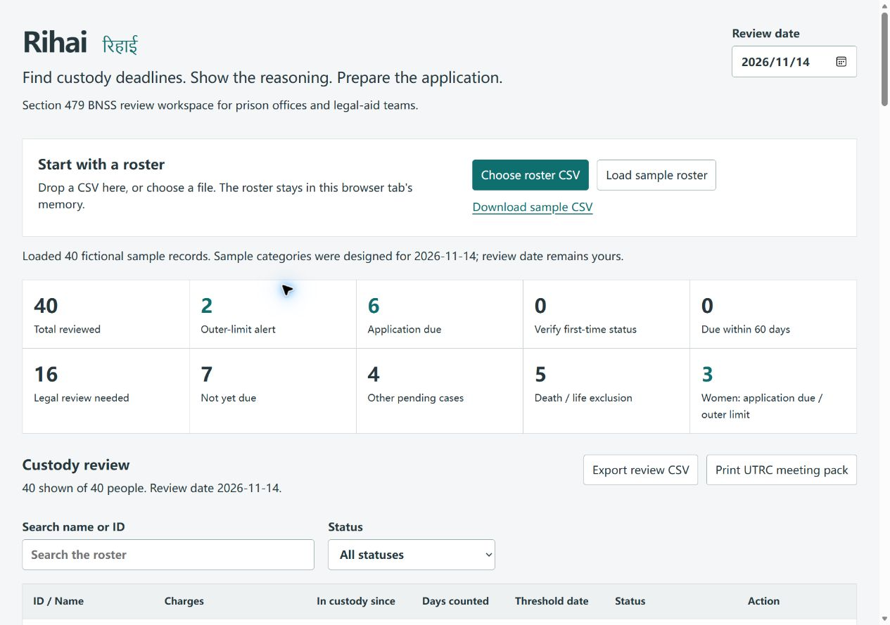

# Rihai — रिहाई

Rihai helps prison offices, Undertrial Review Committees and legal-aid teams identify custody thresholds for Section 479 BNSS review, inspect the calculation for every record and prepare a Superintendent's application draft.

**Status:** local working prototype. Desktop, narrow-screen and native Edge print-preview checks completed on 2026-11-15. Public deployment and AgentFoundry use remain pending; there is no published demo or repository URL yet. See the [browser acceptance record](docs/BROWSER_QA_20261115.md).



## The problem

Identifying a custody deadline requires combining the actual charges, the applicable maximum punishment, continuous custody, prior convictions, other pending proceedings and excluded delay. The [Ministry of Home Affairs implementation advisory](https://origin1504-mha.nic.in/sites/default/files/Advisory%28BNSS%29_17102024.pdf) asks prison authorities to identify relevant undertrial prisoners and move applications. Rihai makes that record-review workflow inspectable; no population or impact estimate is claimed for this prototype.

## What Rihai does

1. Import a roster CSV or load 40 clearly fictional sample records.
2. Review one-third, one-half and current-case outer-limit dates, urgency, calculation traces and unresolved issues.
3. Prepare a conditional application draft, export the review CSV, or print a UTRC meeting pack including records needing review and actionable drafts.

The roster is processed only in browser memory. No backend, account, AI service or browser storage is used. Only the public synthetic sample is fetched. Imported fields are displayed as text; CSV export neutralizes leading spreadsheet formula characters.

## How the rules work

| Case | Prototype action |
| --- | --- |
| Resolved finite sentence, verified first-time status | Calculate the rounded-up one-third date |
| Other / unknown conviction history | Calculate the rounded-up one-half date and also show one-third |
| Unknown first-time status after one-third but before one-half, resolved penalty | Request verification; draft is explicitly conditional |
| Death or life punishment specified | Exclude the fractional-term route |
| Other pending cases before the current-case outer limit | Flag section 479(2) |
| Multiple substantive offences in one case | Keep arithmetic as reference; require legal review |
| Current-case maximum term reached | Alert for court review; do not infer release from other remand orders |
| Unknown act/subsection, dependent or conditional penalty | Require review; show only resolved reference dates |
| BNS 303(2) / 78(2), prior convictions present or unknown | Hold for repeat-penalty review; no application draft |

Rules calculate the thresholds; no model decides a person's eligibility. A person verifies the records and the court determines the application. The reference penalty table is transcribed from the supplied project brief, not independently certified row by row. Unresolved repeat-theft/stalking, highway-robbery and hurt/no-hurt penalty conditions block actionable results; displayed dates remain references. See [legal evidence, assumptions and documented changes](docs/LEGAL_REVIEW.md).

Calendar arithmetic uses UTC days and clamps month-end anniversaries. The date field means the start of continuous custody attributable to the listed case. The prototype does not reconcile interrupted detention or different remand periods across cases.

## Try it locally

Use Node.js 24 for tests. There are no packages to install and no build step.

```sh
npm test
python -m http.server 8000 --bind 127.0.0.1
```

Open `http://127.0.0.1:8000/`. Select **Load sample roster**, use review date **2026-11-14**, expand **Show reasoning**, then open **Draft application** on an actionable row. All asset paths are relative so the application can also run below a static hosting subpath.

The current development preview is `http://127.0.0.1:5197/rihai/` while its local preview process is running. This is not a public deployment.

## Roster format

| CSV column | Meaning |
| --- | --- |
| prisoner_id | Unique local roster identifier |
| name | Record display name |
| gender, age | Supplied demographic fields; gender supports the women-focused review count |
| prison, court, case_no | Draft addressee and recorded case details; missing draft details remain placeholders |
| charges | Explicit legal act and charge subsections preferred; English and documented Hindi aliases supported |
| custody_start | YYYY-MM-DD, continuous listed-case custody start |
| first_time | yes / no / unknown, meaning never convicted of any offence previously |
| other_pending_cases | Non-negative integer or unknown |
| excluded_delay_days | Non-negative whole days attributable to accused-caused procedural delay; blank means zero |
| notes | Local record notes, preserved in export |

All columns are required. Invalid custody, delay and conviction/pending-case fields route the record to review. CSV quoting supports embedded commas, escaped quotes, newlines and UTF-8 BOMs. Unknown law is not silently discarded. Act inference from custody date is only a flagged fallback; the offence date and FIR control verification.

Exports include a `review_date` column from each evaluated record. Clearing or invalidating the review date clears old results, drafts and print content, and disables output controls until recalculation. Explicit Acts are retained across joined charges such as `IPC 323 & 506`; known Act labels such as `NDPS Act 21(a)` are supported. Ambiguous mixed-Act groups remain unresolved.

## Statute table

`src/statutes.js` contains 151 BNS, IPC and NDPS reference entries from the supplied brief. Explicit subsection ambiguity is preserved. BNS 317 is not automatically mapped because the table contains several materially different punishment subsections.

Before adding or certifying a row, a qualified reviewer should check the current statute, punishment limb, commencement, prior-conviction enhancements, jurisdiction and interaction with special-law bail conditions. The [NCRB BNSS compendium](https://cytrain.ncrb.gov.in/staticpage/web_pages/ChaptersBNSS.html) and [BPRD publication](https://bprd.nic.in/uploads/pdf/Final_BNSS.pdf) provide the procedural source; the individual offence rows still need a complete primary-law audit before operational use. Changes need tests for both clear and unresolved cases.

## Built with AgentFoundry — evidence status

This version was written and tested locally by Codex on Windows. No AgentFoundry project, model run, terminal session or build screenshot has been verified. The official AgentFoundry website is accessible and advertises a Windows application; that establishes availability, not actual use. A real AgentFoundry development/verification step and accurate evidence are still needed before claiming this competition requirement is met.

## Deployment and pilot plan

The release is prepared for static hosting, with MIT licensing and a Node test workflow. Publication is pending authorization. No real prisoner records, external users, partner agreement or operational deployment has been used.

A possible future pilot is a month with a DLSA prison legal-aid clinic, after a qualified legal audit and a privacy assessment. There is no existing partner. Intended measures are records flagged, applications actually filed, court outcomes and elapsed time from identification to filing; none are current results.

## Verification

`npm test` currently passes 115 tests covering parsing, fixed-date examples, leaps/month ends, excluded delay, prior-conviction uncertainty, conditional-penalty holds, section 479(2) review, outer-limit scope, unsupported law, CSV safety, per-record review dates, draft placeholders, date-change UI state and the 40-record sample. The UI event tests use a minimal test-only DOM adapter. Separately, actual Edge verification covered 1280px desktop and 390px narrow viewports, date invalidation/recovery, the downloaded 40-row CSV and native print previews. A single application fits one page; the meeting pack uses 11 pages with the tested portrait printer settings. Review-note pagination was corrected after an initial 12-page preview split one note across pages. These checks apply to the supplied synthetic roster and tested settings.

The original sample CSV is unchanged; nine repeat-penalty records now move to review, making 16 review records in total. Software and rendering checks do not certify the legal table. See [screenshots, tested steps and print results](docs/BROWSER_QA_20261115.md).

## License

[MIT](LICENSE).
