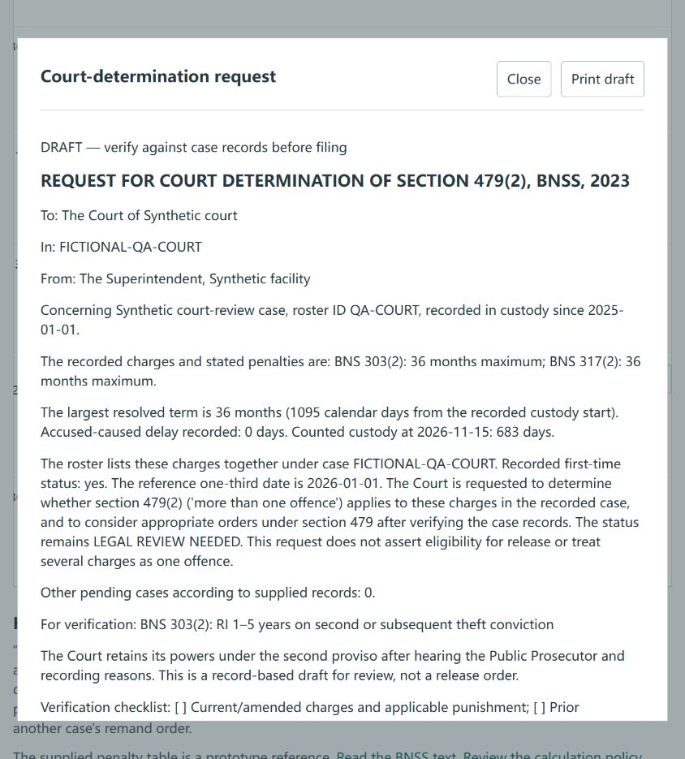

# Rihai review repairs — acceptance, 15 November 2026

## Result

The revision preserves resolved finite current-case outer limits across multiple substantive charges, distinguishes the homicide punishment limbs, and adds a separate court-determination request without changing multi-offence records to application-due. It also prioritizes reference urgency within review records and holds BNS/custody commencement mismatches for record review.

`npm test`: **158 passed, 0 failed**. The original 40-row sample CSV remains unchanged. The reference table now has 155 entries, including four new explicit homicide-limb aliases. Source and policy checks are in [LEGAL_REVIEW.md](LEGAL_REVIEW.md) and [PRIMARY_SOURCE_AUDIT_20261115.md](PRIMARY_SOURCE_AUDIT_20261115.md).

## Actual Edge checks

The separate [six-row fixture](qa-review-20261115/synthetic-review-cases.csv) contains fictional software-regression cases only. It was imported through the page's file chooser on review date 2026-11-15.

| Case | Observed page result |
| --- | --- |
| QA-OUTER — two resolved finite charges past their maximum | Outer-limit alert; normal draft button available |
| QA-PART-II — IPC 304 Pt. II | Due within 60 days; half-term date 2027-01-01; no life exclusion |
| QA-BARE — bare IPC 304 | Legal review needed; no draft |
| QA-UNKNOWN — known finite charge plus unknown charge | Legal review needed; reference outer alert visible; no draft |
| QA-PRE-BNS — BNS charge with custody predating commencement | Legal review needed; reference calculation remains labeled as reference |
| QA-COURT — otherwise resolved, due same-case multiple charges | Legal-review status retained; separate court-request button and dialog |

The actual downloaded [review CSV](qa-review-20261115/review-export.csv) has all six expected statuses and the correct review date. QA-COURT has `court_review_request_available=true` while retaining `NEEDS_REVIEW`; QA-UNKNOWN has `false`. Edge's downloads UI and the downloaded file confirmed completion after the browser automation download event timed out.

## Printing and final browser state

- The new court-determination request produced an actual **one-page portrait print preview** with the court-determination paragraph, checklist, signature and date lines present. [Native preview text](qa-review-20261115/court-print-preview.txt).
- After restoring the original 40-row sample, the actual meeting-pack preview contained **13 pages**, **eight normal applications** and **two court-determination requests**. The added requests account for two pages relative to the previous eleven-page package. [Native preview text](qa-review-20261115/meeting-print-preview.txt).
- The narrow check used 390 CSS pixels. Document/client width was 375px and the court dialog's scroll/client widths both measured 320px; neither had horizontal content overflow. [Captured narrow view](qa-review-20261115/court-review-narrow.jpg).
- No captured page errors or warnings appeared in the inspected browser log. The viewport override was reset, search cleared, print dialogs closed, and the page left with the original 40 fictional records on review date 2026-11-15.

The original sample still shows 2 outer alerts, 6 application-due, 16 legal-review, 7 not-yet, 4 other-case and 5 excluded records. The two separate court requests remain part of the legal-review group; they do not increase application-due or women-application-due counts.

## Development provenance

The [AgentFoundry usage record](AF_USAGE_20261115.md) distinguishes its actual initial editing pass from subsequent Codex completion and external testing. AF's original partial patch is retained locally. The pre-review baseline is commit `27c7504` and the earlier frozen review archive remains intact.

Public repository creation, deployment and official submission are the next release steps. This revision remains local for entrant review.
